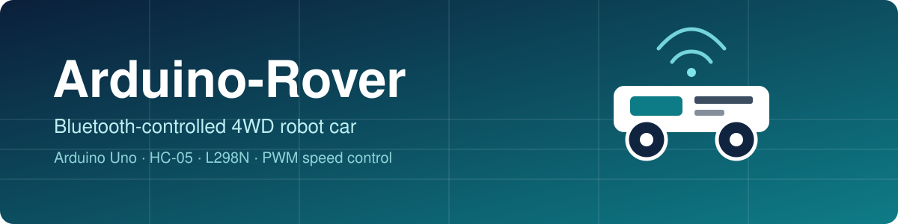
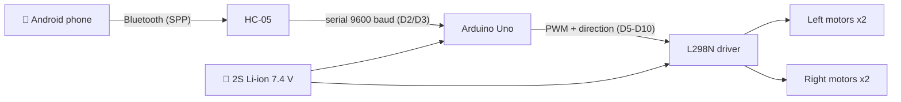

<div align="center">



# 🚗 Arduino-Rover

**A beginner-friendly, Bluetooth-controlled 4-wheel robot car built with an Arduino Uno, an HC-05 module and an L298N motor driver.**


-0082FC?logo=bluetooth&logoColor=white)


[Quick start](#-quick-start) · [Wiring](#-wiring-at-a-glance) · [Controls](#-controls) · [Docs](#-documentation) · [Safety](#-safety-notes) · [Roadmap](#-future-improvements)

</div>

---

## 📖 Overview

Arduino-Rover turns an ordinary 4WD chassis into an Android-controlled car. A phone sends one-letter commands over Bluetooth to an **HC-05** module. An **Arduino Uno** reads them and drives four DC geared motors through an **L298N** driver, with **PWM speed control**. The sketch is a single, well-commented `.ino` file with no external libraries.

The repository contains everything needed to build it: the code, a wiring diagram, a parts list, power and battery guidance, pairing instructions, a simulation guide and a troubleshooting manual.

## ✨ Features

| | Feature |
|---|---|
| 🎮 | Forward, backward, left, right and stop, plus four curved moves |
| 📱 | Android control over Bluetooth (any app that sends single characters) |
| ⚡ | PWM speed control with 10 levels (`0`–`9`) |
| 🛡️ | Safe by design: 3.3 V divider for HC-05 RX, common ground, motors never driven from pins |
| 🔌 | Disconnect failsafe: the car stops if the phone drops out |
| 🧰 | USB Serial Monitor control for easy bench testing without a phone |
| 📚 | Full documentation: parts, wiring, power, setup, simulation, troubleshooting |

## 🧩 How it works



## 🔩 Hardware

| Qty | Part |
|----:|------|
| 1 | Arduino Uno R3 |
| 1 | L298N dual H-bridge driver |
| 1 | HC-05 Bluetooth module |
| 1 | 4WD chassis with 4 × TT gear motors (3–6 V) |
| 2 | 18650 Li-ion cells (protected) + 2-cell holder + charger |
| 1 | Switch, 1 kΩ and 2 kΩ resistors, breadboard, jumper wires |

Full specs, optional parts and rough costs are in [`docs/components.md`](docs/components.md).

## 🔌 Wiring at a glance

<p align="center"></p>

| Arduino | Connects to | | Arduino | Connects to |
|---------|-------------|-|---------|-------------|
| D2 | HC-05 TXD | | D7 | L298N IN1 |
| D3 | HC-05 RXD **via 1 kΩ / 2 kΩ divider** | | D8 | L298N IN2 |
| D4 | HC-05 STATE | | D9 | L298N IN3 |
| D5 | L298N ENA (PWM) | | D10 | L298N IN4 |
| D6 | L298N ENB (PWM) | | VIN | Battery + (via switch) |
| 5V | HC-05 VCC | | GND | Battery −, L298N GND, HC-05 GND |

> ⚠️ The Uno outputs 5 V but the HC-05 RXD pin accepts **3.3 V**. The two-resistor divider is mandatory: see [`docs/wiring.md`](docs/wiring.md#4-hc-05-rx-voltage-divider-why-it-is-required).

## 🚀 Quick start

1. **Gather the parts** from [`docs/components.md`](docs/components.md).
2. **Wire it** following [`docs/wiring.md`](docs/wiring.md). Remove the ENA/ENB jumper caps first.
3. **Upload the sketch.** Open `firmware/rover_bluetooth/rover_bluetooth.ino` in the Arduino IDE, select **Arduino Uno**, and click Upload. Details: [`docs/arduino-ide-setup.md`](docs/arduino-ide-setup.md).
4. **Bench-test over USB** with the wheels lifted. Open the Serial Monitor at 9600 baud and send `F`, then `S`.
5. **Pair your phone** with the HC-05 (PIN `1234`, or `0000`). Steps: [`docs/bluetooth-android.md`](docs/bluetooth-android.md).
6. **Drive.** Connect with a Bluetooth serial app and send the commands below.

## 🎮 Controls

| Send | Action | | Send | Action |
|------|--------|-|------|--------|
| `F` | Forward | | `G` | Forward-left |
| `B` | Backward | | `I` | Forward-right |
| `L` | Spin left | | `H` | Backward-left |
| `R` | Spin right | | `J` | Backward-right |
| `S` | **Stop** | | `0`–`9`, `q` | Speed level (`0` off, `9` or `q` maximum) |

## 📁 Project structure

```
Arduino-Rover/
├── README.md
├── LICENSE
├── firmware/
│   └── rover_bluetooth/
│       └── rover_bluetooth.ino     # complete Arduino sketch
├── docs/
│   ├── components.md               # parts, specs, costs
│   ├── wiring.md                   # pin-to-pin tables, HC-05 divider
│   ├── power.md                    # batteries, limits check, safety
│   ├── bluetooth-android.md        # pairing and commands
│   ├── arduino-ide-setup.md        # install, compile, upload
│   ├── tinkercad.md                # simulation and its limits
│   ├── troubleshooting.md          # fault finding
│   └── testing-status.md           # verified vs. untested
└── media/
    ├── banner.svg
    ├── diagrams/wiring.svg         # wiring diagram
    ├── screenshots/                # add your screenshots here
    └── videos/                     # add your demo videos here
```

## 📚 Documentation

| Guide | What it covers |
|-------|----------------|
| [Components](docs/components.md) | Bill of materials with specifications and rough prices |
| [Wiring](docs/wiring.md) | Every connection, the HC-05 voltage divider, motor direction check |
| [Power & batteries](docs/power.md) | Motor driver and battery limits, battery options, safety rules |
| [Bluetooth & Android](docs/bluetooth-android.md) | Pairing, apps, command reference, failsafes |
| [Arduino IDE setup](docs/arduino-ide-setup.md) | Installing, compiling, uploading, tuning constants |
| [Tinkercad](docs/tinkercad.md) | What can and cannot be simulated |
| [Troubleshooting](docs/troubleshooting.md) | Power, upload, Bluetooth and motor problems |
| [Testing status](docs/testing-status.md) | What is verified and what still needs real hardware |

## ✅ Verification status

Being honest about what has been checked:

* ✔️ The sketch **compiles** for the Arduino Uno (about 5.4 KB flash, 340 bytes RAM).
* ✔️ The command logic passed 21 automated checks on a PC with a mocked Arduino API.
* ✔️ Pin assignments in the code, documentation and diagram were cross-checked by script.
* ⏳ **Not yet tested on real hardware:** motors, PWM behavior, HC-05 pairing, Android apps, battery run time. See [`docs/testing-status.md`](docs/testing-status.md).
* ℹ️ **Tinkercad** can simulate the motor logic via the Serial Monitor but **cannot simulate Bluetooth**.

## ⚠️ Safety notes

* **Never** power the motors from Arduino pins or the Arduino 5 V pin. All motor current comes from the battery through the L298N.
* Keep the **1 kΩ / 2 kΩ divider** on the HC-05 RXD line.
* Join all grounds together (battery −, L298N, Arduino, HC-05).
* Use **protected Li-ion cells** and a proper Li-ion charger. Never charge unattended. Check polarity before first power-up. Consider a 3 A fuse.
* The L298N is rated 2 A per channel, and two stalled TT motors can reach or exceed that. Press `S` if the wheels are blocked.
* Test with the **wheels lifted** first, then in a clear area away from people, pets, stairs and water.

Full details: [`docs/power.md`](docs/power.md).

## 🔭 Future improvements

* Higher-current motor driver (for example dual BTS7960, or a pair of drivers) for more stall margin and less heat loss
* Ultrasonic obstacle avoidance (HC-SR04) with automatic stop
* Per-side motor trim to correct drift
* Smooth acceleration and braking ramps
* Headlights, buzzer and battery-voltage monitoring
* Custom Android app (MIT App Inventor) with a joystick
* Encoder feedback for straight-line driving

## 🖼️ Gallery

Photos, Tinkercad screenshots and demo videos will be added under [`media/`](media/README.md) once the build is tested.

## 📄 License

See the [LICENSE](LICENSE) file.

---

<div align="center">

Built with ❤️ and a lot of jumper wires. If this helped you, consider giving the repository a ⭐.

</div>
