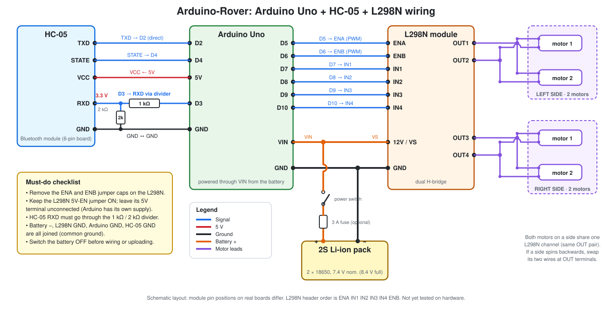

# Wiring Guide

> Turn the battery **off** and unplug USB before changing any wire.
> Diagram: [`media/diagrams/wiring.svg`](../media/diagrams/wiring.svg)



All pin numbers below match the constants at the top of
[`firmware/rover_bluetooth/rover_bluetooth.ino`](../firmware/rover_bluetooth/rover_bluetooth.ino).

## 1. Arduino ↔ L298N (control signals)

| Arduino Uno pin | L298N pin | Function |
|-----------------|-----------|----------|
| D5 (PWM) | ENA | Left motors speed |
| D6 (PWM) | ENB | Right motors speed |
| D7 | IN1 | Left motors direction A |
| D8 | IN2 | Left motors direction B |
| D9 | IN3 | Right motors direction A |
| D10 | IN4 | Right motors direction B |
| GND | GND | Common ground |

**Before wiring ENA and ENB:** pull off the two small jumper caps on the ENA and ENB pins. Those caps tie the enable pins to 5 V (full speed, no PWM control).

The real L298N header order is `ENA IN1 IN2 IN3 IN4 ENB`. The diagram is laid out as a schematic so wires do not cross, so follow the table above and not the picture's vertical order.

## 2. Arduino ↔ HC-05 (Bluetooth)

| HC-05 pin | Connects to | Notes |
|-----------|-------------|-------|
| VCC | Arduino **5V** | Breakout boards have an onboard 3.3 V regulator |
| GND | Arduino GND | Common ground |
| TXD | Arduino **D2** | Direct. HC-05 outputs 3.3 V, which the Uno reads as HIGH |
| RXD | Arduino **D3 through the voltage divider** | **Never connect directly** (see section 4) |
| STATE | Arduino **D4** | Goes HIGH when a phone is connected. Used for the disconnect failsafe |
| EN / KEY | Not connected | Only used for AT-command mode (optional) |

D0 and D1 (the hardware serial pins) are intentionally left free. The HC-05 uses `SoftwareSerial` on D2 and D3, so USB uploads and the Serial Monitor never conflict with Bluetooth.

## 3. L298N ↔ motors, battery and Arduino power

| L298N terminal | Connects to |
|----------------|-------------|
| OUT1 | Left motor 1 (+) **and** left motor 2 (+) |
| OUT2 | Left motor 1 (−) **and** left motor 2 (−) |
| OUT3 | Right motor 1 (+) **and** right motor 2 (+) |
| OUT4 | Right motor 1 (−) **and** right motor 2 (−) |
| 12V (this is VS, the motor supply) | Battery + (through the switch and optional fuse) **and** Arduino VIN |
| GND | Battery − **and** Arduino GND |
| 5V | **Leave unconnected** |

| Battery pack | Connects to |
|--------------|-------------|
| + (red) | Power switch → optional 3 A fuse → L298N 12V terminal and Arduino VIN |
| − (black) | L298N GND terminal and Arduino GND |

Notes:

* Keep the **5V-EN jumper on** the L298N. It enables the onboard regulator that powers the L298N logic from the battery. This is fine with a battery up to 12 V. The "5V" terminal then becomes an output; leave it empty so two 5 V sources are never joined.
* The Arduino is powered through **VIN** from the battery (7–12 V recommended). Details in [power.md](power.md).
* Solder a 0.1 µF ceramic capacitor across each motor's two terminals if you can. It reduces noise.
* Motors are **never** connected to Arduino pins. The Arduino only sends logic signals to the L298N inputs.

### Motor direction check

1. Lift the car so the wheels spin freely.
2. Send `F` (forward).
3. If a **side** turns backward, swap that side's two motor wires at the L298N terminals (for example OUT1 and OUT2 for the left side).
4. If the two motors on one side spin in opposite directions, flip the leads of one of them. Chassis motors are mounted mirrored, so this is normal.

## 4. HC-05 RX voltage divider (why it is required)

The Arduino Uno outputs **5 V** logic. The HC-05's RXD pin is a **3.3 V** input. Sending 5 V into it can shorten the module's life or damage it, and may work for a while before failing.

A voltage divider of two resistors lowers the Arduino's TX signal to a safe level:

```
Arduino D3 ──[ 1 kΩ ]──┬──── HC-05 RXD
                       │
                    [ 2 kΩ ]
                       │
Arduino GND ───────────┴──── HC-05 GND
```

Output voltage = 5 V × 2 kΩ / (1 kΩ + 2 kΩ) ≈ **3.33 V**.

* Build the divider on the breadboard and measure with a multimeter before plugging in the HC-05: with D3 HIGH, the middle point should read about 3.3 V.
* No 2 kΩ resistor? Use two 1 kΩ resistors in series.
* The reverse direction (HC-05 TXD → Arduino D2) needs no divider. The Uno reads 3.3 V as logic HIGH.

## 5. Complete connection checklist

- [ ] ENA and ENB jumper caps removed
- [ ] D5→ENA, D6→ENB, D7→IN1, D8→IN2, D9→IN3, D10→IN4
- [ ] HC-05 VCC→5V, GND→GND, TXD→D2, RXD→D3 **via 1 kΩ/2 kΩ divider**, STATE→D4
- [ ] OUT1/OUT2 → both left motors, OUT3/OUT4 → both right motors
- [ ] Battery + → switch → (fuse) → L298N 12V **and** Arduino VIN
- [ ] Battery − → L298N GND **and** Arduino GND (common ground)
- [ ] L298N 5V terminal left empty, 5V-EN jumper left on
- [ ] No bare wire ends touching; no wire to D0/D1
